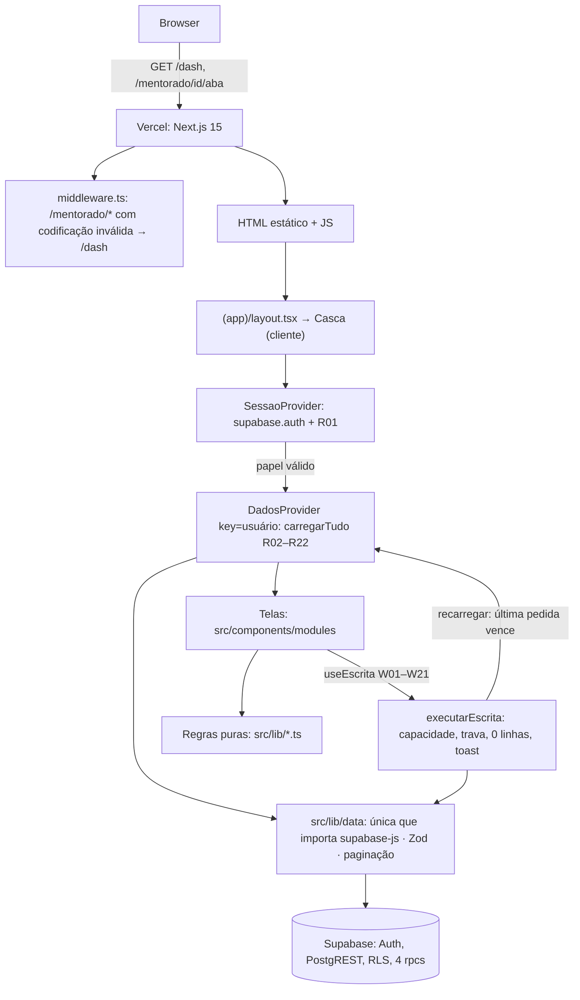

# Migração do front para Next.js — Design

**Spec**: `.specs/features/migracao-nextjs/spec.md`
**Status**: Approved (Lucas, 14/10/2026, com o `tasks.md`) · branch `feat/migracao-nextjs`
**Decisões duráveis**: [AD-007](../../../docs/decisions/007-front-next-dados-no-browser.md). O que só vale para esta migração fica na tabela "Tech Decisions".
**Insumo**: o mapeamento (`docs/planejamento/mapeamento-migracao-nextjs.md`, citado como "mapeamento §N"). `:NNNN` é `index.html:NNNN` em `main@2aea455`.

---

## Abordagem

Três desenhos entregam o mesmo escopo. **Escolhido: A**, por decisão do orquestrador. O Lucas pode trocar na aprovação do Tasks.

| | **A. Rotas do App Router e dados num provedor do cliente** | B. Uma rota catch-all com roteador próprio | C. Dados no servidor com `@supabase/ssr` |
|---|---|---|---|
| Como | Uma pasta por tela em `src/app/(app)/`. O layout do grupo abre a sessão e faz as 20 leituras uma vez, como o `loadAll`. As telas leem de um contexto | `src/app/[[...caminho]]/page.tsx` e um porte do `lerEndereco` escolhem a tela | Server Components leem com o JWT do usuário guardado em cookie; um middleware renova a sessão |
| A favor | Voltar, avançar e link direto nativos. Código separado por rota. Mesmo padrão `(app)/` da plataforma | Porte 1:1 do roteador de hoje. Um lugar só para as guardas | Primeira pintura já com dado. Menos JS |
| Contra | Precisa de middleware para codificação inválida (NAV-03) e de uma ponte para `#/…` | Leva o mesmo 400 em codificação inválida, porque o catch-all também decodifica o parâmetro. Refaz o que o App Router já dá | Contraria a premissa "dados só no browser". A sessão vai para cookie e todo mundo loga de novo. "Hoje" calculado no servidor em UTC (mapeamento §9, risco 9) |

---

## Architecture Overview

O servidor só entrega HTML estático, JS e um middleware de 10 linhas. Nenhum código de servidor lê dado. Toda leitura e escrita sai do browser com a sessão do usuário, e o RLS continua sendo a única autorização (mapeamento §5.3).



**Ciclo de vida:**

1. **Primeira pintura.** O servidor só renderiza a casca com `Skeleton`. Nada que dependa de sessão, dado ou relógio é renderizado no servidor. Isso evita o erro de hidratação e o "hoje" em UTC.
2. **Sessão.** O `SessaoProvider` assina `onAuthStateChange`. O `INITIAL_SESSION` traz a sessão do `localStorage`. A chave é `sb-matgynpiscyoshnjzolo-auth-token`, a mesma do app de hoje (`supabase-js/dist/index.mjs:651`): quem está logado no app antigo continua logado no novo, no mesmo domínio. O callback só guarda a sessão no estado. A leitura do perfil (R01) roda num efeito separado, porque chamar o cliente dentro do callback é o caminho conhecido de deadlock do auth-js. A 2.117.3 enfileira as notificações do `initialize` justamente por isso (`GoTrueClient.js:136–146`, `350–360`).
3. **Papel.** Papel válido monta `DadosProvider` e `UiProvider` com `key={usuario.id}`. Trocar de usuário desmonta os dois e descarta dado e filtro (AUTH-08).
4. **Carga.** `carregarTudo(papel)` dispara as 20 leituras em paralelo, como o `loadAll` (`:736–799`). Antes do fim da primeira carga só aparece `Skeleton` (NAV-08).
5. **Escrita.** O handler chama `useEscrita(capacidade, fn)`. O executor confere a capacidade, trava o botão, chama a porta, confere as linhas e depois chama `recarregar()` (DATA-09).
6. **Saída.** `signOut()` emite `SIGNED_OUT`. O provedor volta a "anônimo", os providers com `key` desmontam e a tela de login nasce com o campo de senha vazio.

---

## Emendas à spec

Vão no mesmo commit deste design. O `validate_spec.py` roda de novo.

| requisito | muda para | por quê |
|---|---|---|
| G0, cabeçalho | "antes do primeiro commit do app (Fase 1)". A Fase 0 (casca do repo, cópia do DS e script de snapshot) roda antes, sob o G1 | G0.2 e G0.3 dependem de um script e de um arquivo versionados |
| G0.3 | passa quando o sha está em `SNAPSHOT` **e** é alcançável pela `origin/main` da plataforma | `NavItem`, `Popover`, `Progress`, `Alert` e `DescriptionList` só existem em 25 commits da `main` local, sem push (conferido com `git cat-file` em 13/10) |
| STACK-01 | versões iguais às **resolvidas** no `pnpm-lock.yaml` da plataforma, fixadas sem `^` e registradas em `SNAPSHOT` | o `package.json` da plataforma usa `^`: o mesmo texto resolve versões diferentes em datas diferentes |
| GATE-06 | "pela técnica do `tests/ambiente.mjs`, num carregador que alimenta o `loadAll` com o snapshot" | o harness não expõe `loadAll` nem `TRANSCRICOES` (`tests/ambiente.mjs:34–45`), e `tests/` sai no corte |
| TEST-03 | `dangerouslySetInnerHTML` **e** atribuição a `innerHTML` só no editor de notas, sempre com a saída de `sanitizarNota` | o editor escreve o HTML pela ref, sem `dangerouslySetInnerHTML` |
| NOTE-03 | "… SHALL ficar só leitura, SHALL não exibir o HTML da nota e SHALL não gravar" | sem DOM, o DOMPurify 3.2.6 devolve o HTML sem sanitizar (`dompurify/dist/purify.es.mjs:1197–1200`) |
| UI-06 | "com primitivo do design system (existente, composição de existentes ou arquivo novo genérico em `src/components/ui/`), sem editar arquivo copiado, e a escolha de cada lacuna registrada num AD" | quatro das sete lacunas fecham com primitivos que já existem (ver "Primitivos novos") |

O threat pass emendou mais 16 ACs e criou SEC-01 a SEC-08: ver a seção "Threat pass".

---

## Code Reuse Analysis

### Design system da plataforma (cópia literal, AD-006)

| elemento de hoje | primitivo | onde |
|---|---|---|
| sidebar, menu mobile, usuário, Sair | `NavItem`, `Drawer`, `Avatar`, `Button`, `ThemeToggle` | casca (UI-08) |
| login | `Card`, `FormField`, `Input`, `Button loading` dentro de um `<form>`: Enter envia nativo (AUTH-03) | `tela-login.tsx` |
| `.btn` com envio | `Button loading`: spinner, `disabled` e `aria-busy` (`button.tsx:34`, WRITE-03) | todo botão de escrita |
| modal; exclusão | `Dialog` (portal, Esc, scroll-lock, foco, `role="dialog"`); `ConfirmDialog` com `confirmDisabled` para o nome digitado (`confirm-dialog.tsx:31`, OPS-11) | modais |
| cards de KPI | `StatCard` | Dashboard, Financeiro, STLSeller |
| `.panel`; listas de atenção | `Card`/`Section`; `Alert` | Dashboard, avisos |
| `.pill` | `Badge` (status e "fora do projeto") | todas |
| `.abas` | `Tabs` com `count` | ficha, NPS, IA |
| tabelas | `DataTable` com `render` por coluna | todas |
| leitura sem edição | `DescriptionList` | ficha para quem não edita (OPS-12) |
| concentração do bruto | `SentimentBar` | STLSeller |
| gráficos | `LineChart` (marcos), `TrendChart view="bar"` (faturamento). O Chart.js sai | Rotas |
| stepper de marcos | `CollapsibleSection` controlado por `marcoAberto` | Rotas (OPS-17) |
| filtros de tipo/período | `SegmentedControl`, `PillGroup` | Sessões, NPS, STLSeller |
| vazio; carregando | `EmptyState`; `Skeleton` (UI-07) | todas |
| toast | `react-hot-toast` com o `Toaster` do layout da plataforma | global |

**Copiado:** `src/design-system/**` e `src/components/ui/**` da plataforma, mais `src/public/fonts/InterVariable.woff2`.
**Fora da cópia:** `ui/chat/**` (pede `react-markdown` e `remark-gfm`), `ui/kanban.tsx` (pede `@dnd-kit`) e `ui/tag.tsx` (pede `@/lib/sector-colors`, domínio da plataforma). Nada do que fica importa esses três. Os testes que vêm junto (`tokens.contrast.test.ts`, `select.test.ts`, `color-swatch-picker.test.ts`) só importam arquivos vizinhos e passam a rodar na nossa suíte.

### Lógica portada do `index.html`

Os nomes de hoje ficam, porque o mapeamento, a spec e a paridade citam esses nomes.

| módulo novo (`src/lib/`) | porta de | requisitos |
|---|---|---|
| `constantes.ts` | `MENTORES`, `MENTORES_HIST`, `TODOS_MENTORES`, `ETAPAS`, `ETAPAS_GRUPO`, `ETAPA_ORD`, `S_STATUS`, `NIVEIS`, `INICIO_COBRANCA_NPS`, `PRAZO_RESPOSTA_DIAS`, `META_ADESAO_EXP`, `LINK_PESQUISA_EXP` (`:561–671`, `:807–809`) | TEST-04 |
| `papeis.ts` | `CAPACIDADES`, `PAPEL_LABEL`, `pode` (`:662–670`) | AUTH-07, NAV-04–06, WRITE-08–09 |
| `endereco.ts` | `lerEndereco`, `TELAS`, `ABAS_FICHA`, as guardas de `aplicarEndereco` (`:1344–1400`), mais `caminhoDoHash` | NAV-01–05 |
| `datas.ts` | `fmtD`, `dpLabel`, `diasAte`, `prazoTexto`, `mesDe`, semana do NPS; `HOJE` vira `hojeSP()` | FIN-06, TEST-05, EDGE-03 |
| `moeda.ts` | `fmtBRL`, `lerBRL`, `mascaraBRL` | OPS-20 |
| `busca.ts` | `casaBusca`, `alvoBuscaData`, `chaveNome` | OPS-10, OPS-11 |
| `sessoes.ts` | `ehGrupo`, `eh1a1`, `agruparGrupo`, `statusGrupo`, `resumoStatusGrupo`, `sessoes1a1De`, `sessoesGrupoDe`, blocos de Sessões | OPS-05–09 |
| `matriz.ts` | `reunioesConcluidas1a1` (`:1445`), matriz, mês padrão, `FOCO_ALERTA` | OPS-02–04, NAV-10 |
| `painel.ts` | os 12 itens de "Precisa de atenção", números gerais, progressão (`nivelDe`), próximas 8 | OPS-01, GER-08 |
| `mentorados.ts` | filtros de Mentorados, `resumoExclusao`, `normalizaEmail`, `msgErroMentorado`, situação | OPS-11, OPS-13 |
| `financeiro.ts` | `cobrancasOrfas`, `motivoOrfa`, `cobrancasDescartadas`, `parcelaDaLia`, `proximaParcela`, cards | FIN-01–05 |
| `rotas.ts` | régua, stepper, montagem do W09 | OPS-16–19 |
| `ordem.ts` | `toggleSort`/`applySort` (`:1198–1230`) viram `alternarOrdem` e `aplicarOrdem` | UI-06 (ordenação) |
| `stlseller.ts`, `nps.ts`, `ia.ts`, `mentores.ts` | agregações de `renderAnalise`, `renderNps`, `renderIa`, `renderMentores` | GER-01–07 |
| `notas.ts` | `NOTA_TAGS`, `sanitizarNota`, detecção de atalho, validação de link, agendador do autosave | NOTE-02–08 |
| `escrita.ts` | o que nenhum handler de hoje faz: capacidade, identidade, trava, conferência de linhas | WRITE-02–08, SEC-06 |
| `links.ts` | `linkOr` (`:965–969`) vira `linkSeguro(url)`: `href` só para `http:` e `https:`, o resto como texto. O React 19 bloqueia `javascript:`, mas deixa `data:` passar | SEC-05 |
| `sessao.ts` | `boot` e `afterLogin` (`:672–708`) viram a máquina de fases da sessão | AUTH-01, AUTH-06–08, EDGE-02 |
| `recarga.ts` | o `loadAll` sem `await` (`:3496`, `:3547`) vira "a última pedida vence" | DATA-09 |

### Integration Points

| sistema | integração |
|---|---|
| Supabase Auth | `signInWithPassword`, `signOut`, `onAuthStateChange`. Sessão no `localStorage`, pelo padrão do supabase-js 2.117.3 |
| PostgREST | só por `src/lib/data/`: leituras R01–R23 e escritas W01–W21 com o contrato do mapeamento §4 |
| rpcs | `experiencia_adesao`, `analise_ia_mentor`, `lia_adotar_orfas`, `lia_refletir_financeiro` (DATA-08) |
| Vercel | mesmo projeto e domínio. `vercel.json` na branch: `{"framework": "nextjs", "installCommand": "pnpm install --frozen-lockfile", "buildCommand": "pnpm build"}`. A doc da Vercel diz que essas chaves sobrepõem as Project Settings por deploy (`vercel.com/docs/project-configuration/vercel-json`, lida em 13/10) |
| plataforma-product-ops | só leitura por `git show <sha>:<caminho>`, nunca pelo working tree |
| app antigo | só na paridade: `git show <merge-base>:index.html`, executado pelo carregador de `scripts/parity/` |

---

## Components

### 1. Rotas (`src/app/`)

- **Purpose**: um endereço por tela, com os nomes do hash de hoje (NAV-01).
- **Location**:

```
src/app/layout.tsx                         <html lang="pt-BR">, Inter, <script src="/theme-init.js">, Toaster
src/app/globals.css                        o da plataforma sem o import de report.css (escrito pelo script de cópia)
src/app/icon.png                           o favicon.png de hoje (CUT-03), pela convenção de arquivo do Next
src/app/page.tsx                           "/": ponte do hash
src/app/not-found.tsx                      caminho desconhecido: substitui por /dash
src/app/(app)/layout.tsx                   <Casca>{children}</Casca>
src/app/(app)/{dash,acompanhamento,mentorados,sessoes,rotas,mentores,analise,nps,ia,financeiro}/page.tsx
src/app/(app)/mentorado/[id]/[[...aba]]/page.tsx
src/middleware.ts
public/theme-init.js                       o script sem flash de tema do layout da plataforma, como arquivo
```

- **Interfaces**:
  - `page.tsx` de cada tela: Server Component de uma linha que renderiza a tela cliente (`<Dashboard modo="completo" />`).
  - Ficha: `async function Page({ params }: { params: Promise<{ id: string; aba?: string[] }> })` → `<Ficha id={id} aba={aba?.[0]} />`. O optional catch-all casa zero ou mais segmentos (`next/dist/shared/lib/router/utils/route-regex.js:58`). A ficha usa só o primeiro, como o `lerEndereco` faz com `[a,b,c]` (`:1364–1366`).
  - `/`: componente cliente. No mount, `substituir(caminhoDoHash(location.hash) ?? "/dash")`. O `caminhoDoHash` monta o caminho só a partir de uma tela de `TELAS` ou de `mentorado/<id>[/<aba de ABAS_FICHA>]`, com o id em `encodeURIComponent`. Qualquer outra forma devolve `null`, inclusive `#//evil.example`, que um mapeamento ingênuo `"/" + resto` transformaria num endereço de outra origem (THREAT-01, NAV-02). O `router.replace` navega com `replaceState`, sem entrada nova no histórico (`next/dist/client/components/app-router-instance.js:296–299`, `app-router.js:106–114`) (NAV-02).
  - `not-found.tsx`: componente cliente que faz `substituir("/dash")` (NAV-03).
- **Dependencies**: `next/navigation` só dentro de `useNavegar`.
- **Reuses**: o layout raiz da plataforma (`src/app/layout.tsx` dela), trocando o `<script dangerouslySetInnerHTML>` por `<script src="/theme-init.js" />`.

### 2. Middleware (`src/middleware.ts`)

- **Purpose**: endereço de ficha com codificação inválida vira Dashboard, em vez da página 400 do Next (NAV-03).
- **Por quê**: o Next decodifica o parâmetro dinâmico antes da página e responde 400 se falhar (`next/dist/shared/lib/router/utils/route-matcher.js:18–22`, `server/base-server.js:948–950`). O middleware roda antes do casamento de rota e aceita caminho que não decodifica (`server/lib/router-utils/resolve-routes.js:308–316`).
- **Interface**: `matcher: ["/mentorado/:path*"]`. Se `decodeURIComponent(pathname)` lança, responde `NextResponse.redirect(new URL("/dash", req.url))`. Senão, `NextResponse.next()`.
- **Não faz**: não lê sessão nem cookie, não toca o banco.
- **PoC**: abre a Fase 2. `next start` local e `curl -s -o /dev/null -w '%{http_code} %{redirect_url}' /mentorado/%E0%A4%A` devolve 307 para `/dash`. No preview da Vercel, o G3.8 confere de novo. Se a borda da Vercel recusar antes do middleware, o NAV-03 reabre como emenda.

### 3. Casca e contextos (`src/components/shell/`)

- **Purpose**: sessão, papel, dado, filtro e navegação num lugar só, injetáveis nos testes.
- **Interfaces** (`contexto.tsx`):
  - `useSessao(): { usuario: { id: string; email: string }; perfil: Perfil; papel: Papel; pode(c: Capacidade): boolean; sair(): Promise<void> }`
  - `useDados(): { dados: Dataset; erros: ErrosDeCarga; recarregando: boolean; recarregar(): Promise<void> }`
  - `useUi(): { ui: Ui; mudar(p: Partial<Ui>): void }`. É o porte dos globais que hoje sobrevivem à troca de tela: `filtro` inteiro, `mesMatriz`, `foco`, `rotaAtual`, `rotaMentoradoId`, `marcoAberto`, `voltarPara` e `sortState` (`:621–654`).
  - `useNavegar(): { ir(caminho: string): void; substituir(caminho: string): void; caminho: string }`. Embrulha `useRouter` e `usePathname`. Nos testes, um stub entra pelo mesmo contexto. É a única porta para o roteador: se `new URL(destino, location.origin).origin !== location.origin`, navega para `/dash` e não entrega o destino (SEC-01). O `router.replace` do Next faz `location.replace` em destino de outra origem, então a guarda tem de ficar antes dele.
- **Arquivos**: `casca.tsx` (gate de sessão, carga, sidebar e menu mobile), `sessao.tsx` (provider de auth), `dados.tsx` (provider de carga), `tela-login.tsx`, `tela-papel.tsx` ("Papel não reconhecido" e "Perfil não encontrado"), `menu.tsx` (itens por papel, NAV-06), `use-escrita.ts`.
- **Regras da casca**:
  - Ao mudar o caminho para fora de `/sessoes`, `foco = null` (NAV-10). Ao mudar para fora de `/mentorado/*`, `voltarPara = caminho`. O item aceso do menu na ficha é o `voltarPara`, como hoje (`:1384–1386`).
  - `/financeiro`, `/analise`, `/nps` e `/mentores` sem `verFinanceiro` fazem `substituir("/dash")` (NAV-04). As abas `financeiro` e `stlseller` sem `verFinanceiro` desenham `sessoes` sem reescrever a URL (NAV-05).
- **Reuses**: o `AppShell` da plataforma como referência de pele (sidebar com `NavItem`), sem copiar o arquivo: ele carrega o login e os papéis dela.

### 4. Porta de dados (`src/lib/data/`)

- **Purpose**: o único lugar que importa `@supabase/supabase-js` (DATA-01).
- **Arquivos e interfaces**:
  - `config.ts`: `SUPABASE_URL` e `SUPABASE_PUBLISHABLE_KEY`, de `process.env.NEXT_PUBLIC_*` com o padrão de produção (`:530–531`), e `validarConfig({ url, chave }): string | null`, uma lista de permissão: a chave começa com `sb_publishable_` ou é JWT com `role` `anon`, e a URL é a de produção. O erro nomeia a variável (STACK-06). Quem chama é o `next.config.ts`, na carga da config: o `next build`, o `next dev` e o `next start` param antes de servir. A checagem roda no `next.config.ts`, não no browser. Ela também não usa nenhum texto de chave secreta: mesmo que o código de `validarConfig` vá parar no bundle do cliente, a varredura do G2.3 não acha a própria guarda (THREAT-02).
  - `cliente.ts`: `cliente(): SupabaseClient`, um singleton preguiçoso, criado só no browser com `createClient(URL, KEY, { auth: { detectSessionInUrl: false } })`. A chave do storage não muda e a sessão de hoje continua valendo (AUTH-09), mas um link com `access_token` na URL deixa de trocar a sessão da aba (AUTH-10, THREAT-10). Nenhum `import` cria cliente.
  - `auth.ts`: `entrar`, `sair`, `ouvirSessao`, `lerPerfil` (R01), `classificarErroLogin` e `usuarioDaSessao(): Promise<string | null>`. Mora aqui porque as classes de erro vêm do supabase-js.
  - `esquemas.ts`: um schema Zod por relação, com as colunas que o código de hoje lê. Os tipos de linha saem de `z.infer`. Coluna é anulável, salvo `NOT NULL` provado em migration ou no snapshot.
  - `paginar.ts`: `lerPaginado<T>(rel: Relacao, consulta: () => Consulta, ordem: Ordem[], schema: z.ZodType<T>): Promise<Resultado<T[]>>`. Páginas de 1.000, `order` acumulado e desempate pela chave única: o `order()` do postgrest-js concatena colunas (`postgrest-js/dist/index.mjs:902–906`) e o `range()` vira `offset`/`limit` (`:1068–1073`). Para quando vem página com menos de 1.000 linhas (DATA-04, DATA-05).
  - `leituras.ts`: `lerPerfil(userId)` (R01), `carregarTudo(papel): Promise<Carga>` (R02–R22, em paralelo) e `lerNota(mentoradoId)` (R23).
  - `escritas.ts`: uma função por escrita, com os nomes do mapeamento §4.2 (`confirmarGrupo`, `criarSessaoGrupo`, `salvarSessao`, `confirmarSessao`, `delSessao`, `salvarCanalMentorado`, `salvarFaturamento`, `excluirFaturamento`, `salvarMarco`, `salvarNota`, `salvarMentorado`, `adotarOrfas`, `salvarSituacao`, `excluirMentorado`, `criarMentorado`, `vincularCobranca`, `descartarCobranca`, `restaurarCobranca`, `refletirFinanceiro`, `toggleParcela`, `addParcela`, `salvarParcela`, `delParcela`). Cada uma devolve `ResultadoEscrita`.
- **Toda função recebe o cliente como último parâmetro, com `cliente()` de padrão.** Os testes passam um falso que captura a chamada e responde do fixture. Nenhum teste toca a rede (TEST-06).
- **Validação**: linha que falha no schema escreve `console.error("[central-elite3d] <relação>: schema mismatch", issues)` e vira falha da relação (DATA-03).
- **Conferência de linhas**: toda escrita leva `.select("<chave>")`, o padrão que só o W13 usa hoje (`:3731`). O `select()` acrescenta `Prefer: return=representation` (`postgrest-js/dist/index.mjs:702–712`), e a resposta traz as linhas afetadas. Lista vazia sem erro é `{ ok: false, zeroLinhas: true }`. Escrita de várias linhas (W01, W02) compara as linhas devolvidas com as pedidas, e menos que o pedido vira `{ ok: false, linhas, esperadas }` (WRITE-02, THREAT-11). O payload, a relação, a operação e o `onConflict` não mudam (WRITE-01).
- **Identidade** (SEC-06, THREAT-09): `carregarTudo(papel, usuarioId)` e o executor de escrita conferem `usuarioDaSessao()` antes de mandar a requisição. Sem sessão, ou com a sessão de outro usuário (login em outra aba), nada sai: a requisição iria como `anon` e voltaria vazia sem erro, ou gravaria com o JWT de outra pessoa. O `SessaoProvider` então mostra a sessão atual.

### 5. Escrita (`src/lib/escrita.ts` + `src/components/shell/use-escrita.ts`)

- **Purpose**: uma regra só para todo botão que grava.
- **Interfaces**:
  - `executarEscrita(o: { pode: boolean; ocupado: { current: boolean }; usuarioId: string; usuarioDaSessao(): Promise<string | null>; escrever(): Promise<ResultadoEscrita>; avisar(msg: string, tipo: "sucesso" | "erro"): void; recarregar(): Promise<void>; sucesso?: string }): Promise<boolean>`. Sem capacidade, não chama `escrever` (WRITE-08). Sessão ausente ou de outro usuário: não chama `escrever` e descarta (SEC-06). Escrita parcial mostra "N de M gravadas" e não mostra sucesso (WRITE-02). Com `ocupado.current`, devolve `false` sem chamar: dois cliques no mesmo tick gravam uma vez (WRITE-04). Erro vira toast (WRITE-05) e 0 linhas vira o aviso de WRITE-02. Devolve `true` só com sucesso, e o modal só fecha com `true`. Recarrega depois de sucesso ou de 0 linhas.
  - `useEscrita(cap: Capacidade, escrever: (...a: A) => Promise<ResultadoEscrita>, sucesso?: string): { executar(...a: A): Promise<boolean>; ocupado: boolean }`. Liga o executor ao `toast`, ao `pode` e ao `recarregar`. O `ocupado` vai para o `loading` do `Button` (WRITE-03).
- **Composições**: W11 seguido de W11b; se o W11b falha, aparece "Cadastro salvo, mas as cobranças da Lia não foram puxadas: <erro>" (WRITE-06). W15–W17 chamam `refletirFinanceiro` quando há dono. Se ele falha, o erro vai para um toast e a tela fica (WRITE-07).

### 6. Telas (`src/components/modules/`)

- **Purpose**: renderizar o que as regras puras devolvem. Componente não calcula regra (STACK-02).
- **Pastas**: `dashboard/` (atende `/dash` e `/acompanhamento` com `modo`), `mentorados/`, `sessoes/`, `ficha/` (topo e 5 abas), `financeiro/`, `rotas/`, `stlseller/`, `nps/`, `ia/`, `mentores/` e `comum/` (`campo-moeda.tsx`).
- **Modal**: cada modal exporta o corpo como componente próprio (`SessaoForm`, `ParcelaForm`, `NovoMentoradoForm`…) e um invólucro com o `Dialog`. O `Dialog` devolve `null` quando não há `document` (`ui/dialog.tsx:65`), e no vitest `node` não há. Os testes renderizam o corpo.
- **Clique de linha**: a primeira célula leva um `<Link>` para a ficha, em vez de `onClick` no `<tr>`. Ele é alcançável por teclado e não exige mudar o `DataTable`.
- **Escopo de erro por relação** (DATA-07): cada tela declara as relações essenciais e as complementares para o `AvisoRelacoes`, exportado por `shell/dados.tsx`. Falha de essencial troca o conteúdo por `EmptyState` com "Tentar de novo". Falha de complementar põe um `Alert` no topo, com o nome do que faltou, e o resto renderiza.

| tela | essenciais (além de R02/R03, R04, R06) | complementares |
|---|---|---|
| Dashboard / Acompanhamento | — | R05, R09, R10, R13, R17, R18, R20 |
| Mentorados, Sessões | — | — |
| Ficha | — | aba STLSeller: R14–R16 (essenciais da aba); aba Notas: R23 (estado próprio) |
| Rotas | R07, R08, R09, R10, R11, R12 | — |
| Financeiro | — | R05 (só os painéis de órfãs e descartadas) |
| STLSeller | R14, R15, R16 | — |
| NPS | aba Sessões: R17; aba Experiência: R18 | — |
| Análise IA | admin e diretoria: R19; mentor: R21 | R17 (médias) |
| Mentores | — | R17, R19, R22 |

O erro da Experiência (R18) deixa de derrubar a tela IA (mapeamento §10, item 8).

### 7. Editor de notas (`src/components/modules/ficha/editor-notas.tsx` + `src/lib/notas.ts`)

- **Purpose**: AD-004 sem perda de edição (NOTE-01–08).
- **Desenho**: `div contentEditable` **não controlado**. O JSX não tem filho; o HTML entra por `ref.current.innerHTML = sanitizarNota(html)` uma vez por abertura. É o único `innerHTML =` do app. Assim o React nunca reconcilia o conteúdo e o cursor não pula (mapeamento §9, risco 13).
- **Interfaces** (`notas.ts`):
  - `sanitizarNota(html: string, purify = DOMPurify): string | null` devolve `null` quando `!purify.isSupported`. Com DOM, chama `purify.sanitize(html, { ALLOWED_TAGS: NOTA_TAGS, ALLOWED_ATTR: ["href", "class"], ALLOW_DATA_ATTR: false, ALLOWED_URI_REGEXP: /^https?:/i })`, e um hook `uponSanitizeAttribute` passa o `class` por `filtrarClasses`, que só deixa `checklist` e `feito` (NOTE-02 emendado). A config de hoje (`:3352–3354`) deixava `class` livre: com o Tailwind do app, um mentor poderia cobrir a tela do admin com `fixed inset-0 z-50` e um link falso (THREAT-07). Roda ao abrir, ao colar e ao salvar.
  - `atalhoPara(textoDoBloco: string, tecla: " " | "Enter"): ComandoNota | null`: `#`, `##`, `###`, `-`, `*`, `1.`, `>`, `[]` com espaço; três crases e `---` com Enter (NOTE-07). O `execCommand` fica no componente.
  - `linkValido(texto: string): string | null`: só `http:` e `https:`, por `new URL` (NOTE-08). O link é pedido num `Dialog` com `Input`, sem `prompt()`.
  - `criarAutosave({ salvar, atraso = 1000, agendar, cancelar }): { mudou(html: string): void; descarregar(): void }`. `mudou` reagenda; `descarregar` grava na hora o pendente, se houver.
- **Saída sem perda** (NOTE-05): a cada `input`, o HTML vai para `htmlRef` (uma ref de string, não o nó). O cleanup do efeito chama `descarregar()` com `htmlRef.current`, sem ler o DOM, porque a ref do nó já pode estar solta quando o cleanup roda. `visibilitychange` para `hidden` também descarrega, no lugar do `beforeunload` assíncrono de hoje (`:3405`). O editor registra o `descarregar` em `registrarPendencia` (`src/lib/sessao.ts`), e o `sair()` espera `descarregarPendencias()` antes do `signOut`, para a nota não sair com o JWT de ninguém (SEC-06).
- **Sem sanitizador** (NOTE-03 emendado): `Alert` "O editor não abriu com segurança neste navegador", sem `contentEditable`, sem HTML e sem gravar.
- **Diretoria** (NOTE-06): sem barra e sem `contentEditable`. O conteúdo sanitizado aparece só para leitura.
- **Limite** (EDGE-04): o erro do banco vai para o toast e o texto continua no editor; nada limpa o nó.

### 8. Primitivos novos e lacunas do DS

Cada lacuna do mapeamento §8 fecha sem editar arquivo copiado. A escolha de cada uma vai para o AD-008, escrito na fase dos primitivos (UI-06 emendado).

| lacuna | resolução | arquivo |
|---|---|---|
| data única | `Input type="date"` do DS: o campo nativo devolve `AAAA-MM-DD`, o mesmo valor que o `dateField` grava (`:1028–1040`) | nenhum novo |
| mês | dois `Select` do DS (mês e ano) compostos no módulo, com valor `AAAA-MM`. Hoje o único `monthField` é o do faturamento (`:2440`), com padrão no mês corrente. `type="month"` foi descartado: só o Chromium de desktop e os navegadores mobile têm o controle; os outros caem em texto livre (MDN, `input type="month"`, lida em 13/10) | `modules/rotas/campo-mes.tsx` |
| moeda BRL | `Input` do DS com `inputMode="decimal"`, `mascaraBRL` no `onChange` e `mascaraBRL(v, true)` no `onBlur`, como `:2441`. O `NumberInput` não serve: apaga o ponto (`number-input.tsx:32`) e "2000.50" vira 200050 | `modules/comum/campo-moeda.tsx` |
| combobox | `Popover` + `SearchInput` + lista, com `casaBusca`. Troca de mentorado só no clique ou no Enter | `modules/rotas/escolher-mentorado.tsx` |
| trilha de 12 segmentos | primitivo novo: `SegmentedProgress({ segments: { tone: "success" \| "primary" \| "warning" \| "danger" \| "neutral"; label: string }[]; label: string })` | `ui/segmented-progress.tsx` |
| paginação | primitivo novo: `Pagination({ page, pageCount, onChange, label })`, com "Página X de Y" e dois `Button` de ícone | `ui/pagination.tsx` |
| ordenação | primitivo novo: `SortHeader({ label, direction: "asc" \| "desc" \| null, onToggle })` no `header` da coluna, porque o `sortable` do `DataTable` só desenha o ícone (`data-table.tsx:26`, `:351`). A ordem em si é regra: `aplicarOrdem` em `src/lib/ordem.ts`, porte de `:1198–1230` | `ui/sort-header.tsx` |
| clique de linha | `<Link>` na primeira célula (componente 6) | nenhum novo |

Os três primitivos novos são genéricos, em inglês e sem domínio, para poderem subir para a plataforma.

### 9. Cópia do design system (`scripts/sync-design-system.mjs`)

- **Purpose**: "atualizar é copiar de novo" (AD-006), com prova byte a byte (UI-01).
- **Interface**: `node scripts/sync-design-system.mjs <repo-da-plataforma> <sha>`.
  1. Avisa em `stderr` quando o `sha` não é ancestral da `origin/main` da plataforma. Não recusa: quem barra é o G0.3, e a Fase 0 não deve esperar o push da plataforma para andar.
  2. Lê os blobs por `git ls-tree -r <sha>` e `git show <sha>:<caminho>`, nunca pelo working tree, e escreve nos mesmos caminhos, menos as exclusões.
  3. Escreve `src/app/globals.css` a partir do da plataforma, sem a linha `@import "../components/reports/report.css"`.
  4. Lê as versões resolvidas dos 8 pacotes de STACK-01 no `pnpm-lock.yaml` daquele `sha`.
  5. Grava `src/design-system/SNAPSHOT`.
- **`SNAPSHOT`** (texto):

```
sha a44b129…            # commit da plataforma
versao next 15.5.21     # uma linha por pacote de STACK-01
blob <sha1-git> src/components/ui/button.tsx
…                       # uma linha por arquivo copiado, como o git ls-tree imprime
```

- **Teste** (`src/design-system/snapshot.test.ts`): para cada `blob`, calcula o hash git do arquivo local (`sha1("blob " + tamanho + "\0" + bytes)`) e compara. Também confere que o `package.json` fixa as versões de `versao` e que nenhum arquivo copiado ficou fora do `SNAPSHOT`. Com isso, qualquer pessoa com a plataforma confere a cópia por `git ls-tree`.

### 10. Paridade (`scripts/parity/`)

- **Purpose**: GATE-05, GATE-06 e GATE-07.
- **`snapshot.mjs`** (Node puro, `pnpm parity:snapshot`): pede e-mail e senha no terminal com eco desligado, entra com supabase-js 2.117.3 (`persistSession: false`, `signOut` no fim) e lê R01–R22. Recusa gravar se a pasta já existe com modo diferente de `0700` e a exclui do Time Machine com `tmutil addexclusion` (GATE-05 emendado, THREAT-03). Inclui `mentorados_basic`, que o admin também lê. R20 e R21 são lidos pela rpc: a `analise_ia_mentor()` devolve ao admin o mesmo recorte do mentor (`supabase/migrations/20261013_analise_ia_mentor.sql:10–20`). Pagina com a mesma ordem e desempate da porta. Confere que cada chave de desempate existe e é única, e falha alto se não for. Grava `~/.central-elite3d-paridade/snapshot-<data>.json` com a pasta em `0700` e o arquivo em `0600`. Imprime só contagens. **Quem roda é o Lucas, num terminal dele**: a senha nunca passa pela sessão do agente.
- **`legado.mjs`**: carregador do app antigo. Recebe o `index.html` do merge-base (`git show`), o snapshot, o papel e o "hoje". Reusa a técnica de `tests/ambiente.mjs`: extrai o `<script>`, tira o `boot()`, roda com stubs de DOM e de `location`. O cliente Supabase falso responde do snapshot e respeita `select/order/range/limit/eq/single/maybeSingle`. Chama o `afterLogin` real, que roda o `loadAll` real. Depois navega pelo hash e lê o HTML de cada tela.
- **`metricas-legado.mjs`** e **`metricas.ts`**: uma função por PAR-01…PAR-17 em cada lado. As duas devolvem `Record<chave, valor>` com chave estável (id, mês, mentor normalizado, rótulo do item). O lado antigo lê o HTML pelas âncoras de hoje (`#risco`, `#sem-subida`, `openMentorado('<id>'`…) e pelos símbolos que o script expõe. O lado novo chama as regras de `src/lib/`.
- **`paridade.parity.ts`** (`pnpm parity`, com `vitest.parity.config.ts`): fixa o relógio com `vi.setSystemTime(<hoje do snapshot, 12:00 em SP>)` antes de carregar os dois apps. Valida cada linha do snapshot contra `esquemas.ts`, e linha que falha conta como divergência. Roda os três papéis, compara as métricas e imprime só `PAR-xx | chave | falta, sobra ou valor diferente`. Os dois valores vão para `divergencias-<data>.json` (`0600`) na pasta do snapshot: PAR-05, PAR-12 e PAR-13 carregam R$ por mentorado, e o que sai na tela entra no transcript do agente (GATE-07 emendado, SEC-02). Sai com código 1 se houver divergência fora do Apêndice A.
- **Papéis na paridade**: diretoria lê os mesmos dados do admin. Para o mentor, R02 vira R03, R04, R05 e R14–R19, R22 vêm vazios, e entra R21. É o que o `loadAll` pede por papel (`:737–766`).
- **Fora do `pnpm test`**: precisa do snapshot e do merge-base, então não roda offline (TEST-06).

### 11. Testes

- **Runner**: vitest 4, `environment: "node"`, `include: ["src/**/*.test.{ts,tsx}"]`, alias `@` e `oxc.jsx.runtime: "automatic"`, como a plataforma. Não há `setupFiles` nem MSW.
- **Telas**: `src/test/render.tsx` exporta `renderTela(el, { papel, dados, ui, navegar? })`. Ele monta os quatro contextos com valores de fixture e devolve `renderToStaticMarkup`. Os fixtures (`src/test/fixtures.ts`) portam os de `tests/ambiente.mjs:193–340`, com o XSS de `:31`.
- **Varreduras estáticas** (`src/test/varreduras.test.ts`): uma asserção por regra.

| regra | o que varre |
|---|---|
| DATA-01 | import de `@supabase/supabase-js` fora de `src/lib/data/` |
| STACK-05 | `process.env.` com nome diferente dos dois `NEXT_PUBLIC_*` |
| STACK-07 | `service_role`, `SUPABASE_SERVICE_ROLE_KEY` e `sb_secret_` em `src/` ou no `next.config.ts` |
| STACK-08 | `<script src="http`, `<link href="http`, `fonts.googleapis`; versões exatas de supabase-js e dompurify; ausência de `chart.js` |
| TEST-03 | `dangerouslySetInnerHTML`, `.innerHTML =`, `.outerHTML =`, `insertAdjacentHTML`, `createContextualFragment` e `execCommand("insertHTML"` fora do editor, ou sem `sanitizarNota(` |
| GATE-03 | `evidence/` com HAR, `Authorization`, `/auth/v1/`, `refresh_token` ou texto em formato JWT |
| SEC-07 | `packageManager` fixo; `pnpm.onlyBuiltDependencies` presente |
| UI-02 | hexa, `rgb(`, `rgba(` e paleta padrão do Tailwind em `src/components/modules/` e `src/app/` |
| UI-05 | `window.confirm`, `window.prompt`, `window.alert`, `confirm(`, `prompt(`, `alert(` |
| UI-03 | `next/font/google` e `Manrope` |

- **Varredura de papel**: `src/test/papeis.test.tsx` renderiza as 10 telas, a ficha e os corpos de modal como diretoria, admin e mentor, e conta controles de escrita pelo atributo `data-escrita="W.."` que todo botão de escrita leva (WRITE-09). Ser um atributo explícito, e não um texto de template, é o que deixa a varredura sobreviver ao fim do `innerHTML`.
- **Porte dos 20 grupos** (TEST-01):

| grupo do mapeamento §7 (asserções) | teste novo |
|---|---|
| Formatadores e campo de data (33) | `lib/datas.test.ts`, `lib/moeda.test.ts` |
| 1:1 × grupo (18) | `lib/sessoes.test.ts` |
| Telas do admin (39); Modais e telas (110) | `test/xss.test.tsx` e um teste por tela em `modules/*/*.test.tsx` |
| Escrita do grupo (10); Etapa deduzida (7) | `lib/data/escritas.test.ts` (W01–W04) e `modules/sessoes/*.test.tsx` |
| Papel mentor (29) | `test/papeis.test.tsx`, `lib/endereco.test.ts` |
| Papel diretoria (25); Controle negativo com admin (1) | `test/papeis.test.tsx` |
| Matriz por mentor (15); Alertas que focam linhas (18) | `lib/matriz.test.ts` |
| Busca e botão de criar (60); Busca por data (13) | `lib/busca.test.ts` e os testes de tela |
| Exclusão (14); E-mail do mentorado (13); Ficha criada pela Lia (9) | `lib/mentorados.test.ts`, `modules/ficha/*.test.tsx` |
| Cobrança órfã (24); Parcelas da Lia (17) | `lib/financeiro.test.ts`, `modules/financeiro/*.test.tsx` |
| Rotas (33) | `lib/rotas.test.ts` |
| Notas (9) | `lib/notas.test.ts`, `modules/ficha/editor-notas.test.tsx` |

O sanitizador real não roda no vitest `node`: o DOMPurify sem DOM devolve a entrada. Os testes de NOTE-02 injetam um `purify` falso e conferem a config e os três momentos. O sanitizador de verdade é conferido no G3.6, colando `` na nota do registro de teste e relendo o que foi gravado.

---

## Data Models

```typescript
type Papel = "admin" | "diretoria" | "mentor";
type Capacidade =
  | "verFinanceiro" | "verIa" | "criarMentorado" | "editarMentorado" | "editarFinanceiro"
  | "criarSessao" | "excluir" | "escreverSessao" | "escreverRotas" | "escreverNotas";

type Relacao =
  | "mentorados" | "mentorados_basic" | "parcelas" | "lia_cobrancas" | "sessoes" | "rotas"
  | "marcos_definicao" | "mentorado_marcos" | "faturamento_mensal" | "canais" | "mentorado_canais"
  | "sessoes_orfas" | "stlseller_mentorados" | "stlseller_pedidos_marketplace"
  | "stlseller_produtos_vendidos" | "nps_respostas" | "experiencia_respostas" | "nps_analises"
  | "experiencia_adesao" | "analise_ia_mentor" | "transcricoes";

type Resultado<T> = { ok: true; dados: T } | { ok: false; erro: string };
type ResultadoEscrita = { ok: true; linhas: number } | { ok: false; erro: string; zeroLinhas?: true };

interface Dataset {               // um campo por relação, com o tipo de z.infer do schema dela
  mentorados: Mentorado[];        // R02 ou R03, conforme o papel
  parcelas: Parcela[];
  cobrancas: Cobranca[];
  sessoes: Sessao[];
  rotas: Rota[]; marcos: MarcoDef[]; mentoradoMarcos: MentoradoMarco[];
  faturamento: Faturamento[]; canais: Canal[]; mentoradoCanais: MentoradoCanal[];
  orfas: SessaoOrfa[];
  stlseller: StlMentorado[]; stlPedidos: StlPedido[]; stlProdutos: StlProduto[];
  nps: NpsResposta[]; experiencia: ExpResposta[];
  analise: Analise | null;        // R19 ou R21
  adesao: Adesao | null;          // R20
  transcricoes: Transcricao[];
}
type ErrosDeCarga = Partial<Record<Relacao, string>>;
type Carga = { dados: Dataset; erros: ErrosDeCarga };   // falha de R02/R03, R04 ou R06 vira { ok: false } antes
```

### Leituras (mapeamento §4.1, com a ordem nova)

A ordem de hoje fica e ganha o desempate pela chave única. Chave marcada com "†" não está em migration versionada (mapeamento §6.5): o `snapshot.mjs` confere que ela existe e é única antes do G0.2 fechar.

| # | relação | ordem | desempate | papéis |
|---|---|---|---|---|
| R01 | `profiles` (`eq id`, `.single()`) | — | — | todos |
| R02 / R03 | `mentorados` / `mentorados_basic` | `data_fechamento` | `id`† | admin, diretoria / mentor |
| R04 | `parcelas` | `numero` | `id`† | admin, diretoria |
| R05 | `lia_cobrancas` | `due_date` | `id` (`20260917_lia_pagamentos.sql:65`) | admin, diretoria |
| R06 | `sessoes` | `ordem` | `id`† | todos |
| R07, R08, R11 | `rotas`, `marcos_definicao`, `canais` | `ordem` | `id`† | todos |
| R09 | `mentorado_marcos` | — | `mentorado_id, marco_id` (o `onConflict` do W09) | todos |
| R10 | `faturamento_mensal` | — | `id`† | todos |
| R12 | `mentorado_canais` | — | `mentorado_id, rota_id` (o `onConflict` do W06) | todos |
| R13 | `sessoes_orfas` (view) | — | `id`† | todos |
| R14 | `stlseller_mentorados` | — | `email` (`20260922_stlseller_estruturado.sql:22`) | admin, diretoria |
| R15 | `stlseller_pedidos_marketplace` | — | `email, marketplace` (`:55`) | admin, diretoria |
| R16 | `stlseller_produtos_vendidos` | `faturamento desc` | `email, marketplace, anuncio_id` (`:72`) | admin, diretoria |
| R17 | `nps_respostas` | `respondido_em desc` | `id`† | admin, diretoria |
| R18 | `experiencia_respostas` | `respondido_em desc` | `origem_id` (`20261008_experiencia_e_analista_nps.sql:19`) | admin, diretoria |
| R19 | `nps_analises` | `gerado_em desc`, `limit 1` | — | admin, diretoria |
| R20 | rpc `experiencia_adesao(p_desde, p_prazo_dias)` | — | — | todos (GATE-08 permite) |
| R21 | rpc `analise_ia_mentor()` | — | — | mentor |
| R22 | `transcricoes`: `mentor, status, realizada_em, mentorado_id, drive_id` | — | `drive_id` (`20261013_transcricoes_e_dossies.sql:16`) | admin, diretoria |
| R23 | `mentorado_notas` (`eq mentorado_id`, `maybeSingle`) | — | — | todos |

R22 ganha `drive_id` no `select` para o desempate não depender de ordenar por coluna fora da lista.

### Escritas (mapeamento §4.2)

O payload, a operação e o `onConflict` são os da tabela do mapeamento. A única coisa nova é o `.select(<chave>)` para contar linhas.

| W | função da porta | conferência |
|---|---|---|
| W01–W05 | `confirmarGrupo`, `criarSessaoGrupo`, `salvarSessao`, `confirmarSessao`, `delSessao` | `select("id")` |
| W06, W09 | `salvarCanalMentorado`, `salvarMarco` | `select("mentorado_id")` |
| W07, W08 | `salvarFaturamento`, `excluirFaturamento` | `select("id")` |
| W10 | `salvarNota` | `select("mentorado_id")` |
| W11, W12, W13 | `salvarMentorado`, `salvarSituacao`, `excluirMentorado` | `select("id")` |
| W11b | `adotarOrfas` (rpc) | erro da rpc |
| W14 | `criarMentorado` | `.select().single()`, como hoje |
| W15–W17 | `vincularCobranca`, `descartarCobranca`, `restaurarCobranca` (+ `refletirFinanceiro`) | `select("lia_bill_id")`; erro da rpc à parte |
| W18–W21 | `toggleParcela`, `addParcela`, `salvarParcela`, `delParcela` | `select("id")` |

O `select` pede leitura das linhas devolvidas. Todo papel que escreve numa relação também a lê (mapeamento §5.2), então a conferência não produz falso "nada foi gravado".

### Estado de interface

```typescript
interface Ui {
  filtro: {                           // as mesmas chaves do `filtro` de :625
    q: string; mentor: string; statusFin: string; tipoSessao: string;
    qDash: string; qSessoes: string; qFin: string; qRotas: string; qAnalise: string; qNps: string;
    npsPeriodo: "semana" | "mes"; npsMentor: string; mentorSel: string;
    npsPagPeriodo: number; npsPagResp: number; npsAba: string; iaAba: string; iaSel: string;
  };
  mesMatriz: string | null;           // null = padrão de OPS-04
  foco: { ids: string[]; titulo: string; dica: string } | null;
  rotaAtual: string | null; rotaMentoradoId: string | null; marcoAberto: string | null;
  voltarPara: string;                 // começa em "/mentorados", como :1360
  sortState: Record<string, { coluna: string; direcao: "asc" | "desc" }>;
}
```

---

## Error Handling Strategy

| cenário | tratamento | o que o usuário vê |
|---|---|---|
| sem sessão | provider em "anônimo" | tela de login (AUTH-01) |
| credencial recusada: `code === "invalid_credentials"` ou status 400 | `classificarErroLogin` | "E-mail ou senha inválidos." (AUTH-04) |
| rede: `isAuthRetryableFetchError` (status 0 ou 5xx, `auth-js/dist/main/lib/fetch.js:32–53`) | idem | "Sem conexão com o servidor. Tente de novo." (AUTH-05) |
| limite: status 429 | idem | "Muitas tentativas. Aguarde alguns minutos e tente de novo." (AUTH-05) |
| outro erro do Auth | idem | "Não foi possível entrar: <mensagem>.", sem falar em senha |
| `profiles` sem linha ou com erro | `signOut()` | "Perfil não encontrado" (AUTH-06) |
| papel nulo ou desconhecido | sem carga de dado | "Papel não reconhecido" com Sair (AUTH-07) |
| renovação da sessão falha sem volta | o auth-js apaga a sessão e emite `SIGNED_OUT` (`GoTrueClient.js:4296–4316`, `4421–4437`) | login (EDGE-02). Falha de rede não apaga a sessão: a carga mostra o erro |
| R02/R03, R04 ou R06 falha na 1ª carga | `status: "erro"` | mensagem e "Tentar de novo" (DATA-06) |
| uma delas falha numa recarga | o dataset anterior fica | toast com o erro |
| outra relação falha | `erros[rel]` | tabela do componente 6 (DATA-07) |
| linha fora do schema | `console.error` + falha da relação | idem (DATA-03) |
| escrita com erro | toast; o executor devolve `false` | formulário aberto com o que foi digitado (WRITE-05) |
| escrita com 0 linhas | toast | "Nada foi gravado: sem permissão ou registro não encontrado." (WRITE-02) |
| W11b falha | toast | "Cadastro salvo, mas as cobranças da Lia não foram puxadas: <erro>" (WRITE-06) |
| `lia_refletir_financeiro` falha | toast | o resto da tela fica (WRITE-07) |
| nota grande demais | toast com o erro do banco | o texto fica no editor (EDGE-04) |
| sanitizador indisponível | editor só leitura, sem HTML | `Alert` (NOTE-03) |
| caminho desconhecido | `not-found` → `/dash` | Dashboard (NAV-03) |
| `/mentorado/*` com codificação inválida | middleware → `/dash` | Dashboard (NAV-03) |
| `#/…` com codificação inválida ou fora das formas conhecidas | `caminhoDoHash` devolve `null` → `/dash` | Dashboard (NAV-02) |
| destino de outra origem pedido ao roteador | `useNavegar` → `/dash` | Dashboard (SEC-01) |
| sessão ausente ou de outro usuário na hora de ler ou escrever | nada é enviado; a escrita pendente é descartada | a tela da sessão atual (SEC-06) |
| escrita de várias linhas com menos linhas que as pedidas | toast | "N de M gravadas", sem sucesso (WRITE-02) |
| link do banco que não é `http(s)` | `linkSeguro` devolve `null` | o valor como texto (SEC-05) |
| status fora de `S_STATUS` | texto cru, escapado pelo React | a tela inteira (EDGE-05) |
| chave fora da lista de permissão, ou URL que não é a de produção | `validarConfig` devolve o erro e o `next.config.ts` lança | `next build`, `next dev` e `next start` param com o nome da variável (STACK-06) |

Toda falha de leitura e de escrita escreve `console.error("[central-elite3d] <contexto>", detalhe)`.

---

## Risks & Concerns

| concern | location | impact | mitigation |
|---|---|---|---|
| A plataforma tem 25 commits sem push na `main`, inclusive `NavItem`, `Popover`, `Progress`, `Alert` e `DescriptionList` | `plataforma-product-ops` `main` (`a44b129`) × `origin/main` (`5c7cba9`) | um `SNAPSHOT` com sha só local não é reproduzível, e o UI-08 depende do `NavItem` | G0.3 emendado: o sha precisa ser alcançável pela `origin/main`. Push na `main` da plataforma é deploy dela: decisão do Lucas, pedida no G0 |
| Next responde 400 a parâmetro mal codificado antes da página | `next/dist/shared/lib/router/utils/route-matcher.js:18–22` | NAV-03 falha sem middleware | middleware com PoC no começo da Fase 2; G3.8 confere na Vercel |
| DOMPurify sem DOM devolve o HTML sujo | `dompurify/dist/purify.es.mjs:1197–1200` | XSS se a nota fosse renderizada no SSR; teste no `node` não prova sanitização | editor só no cliente; `sanitizarNota` devolve `null` sem suporte; G3.6 cola XSS de verdade |
| O sanitizador de hoje devolve `""` sem DOMPurify e grava por cima | `:3352–3354`, `:3401` | nota apagada calada | NOTE-03 emendado; `salvarNota` só com `sanitizarNota` não nulo |
| `HOJE` congelado no carregamento | `:606` | prazo errado com a aba aberta de um dia para o outro | `hojeSP()` na hora do uso (EDGE-03, TEST-05) |
| paginação que empata e 13 leituras que cortam em 1.000 | `:726–735`, `:736–766` | fechamento subnotificado | desempate por chave única; teste com 2.500 linhas (DATA-05) |
| chaves "†" sem migration versionada | mapeamento §6.5 | desempate por coluna que não existe quebra a leitura | `snapshot.mjs` confere existência e unicidade antes do G0.2 |
| schema do núcleo fora do repo | mapeamento §6.5 | Zod estrito demais derruba relação em produção | schemas validados contra o snapshot no `pnpm parity`, antes do G2 |
| `Dialog` não renderiza no servidor | `ui/dialog.tsx:65` | TEST-02 não acharia o conteúdo dos modais | corpo de modal exportado e testado à parte (componente 6) |
| `DataTable` sem ordenação, clique e paginação | `ui/data-table.tsx:26`, `:351` | tabelas perderiam ordenação e navegação | `SortHeader`, `Pagination`, link na 1ª célula (componente 8) |
| `NumberInput` lê "2000.50" como 200050 | `ui/number-input.tsx:32` | valor gravado 100× maior | moeda pelo `Input` com `mascaraBRL` (OPS-20) |
| `contenteditable` sob o React | mapeamento §9, risco 13 | cursor pulando, conteúdo duplicado | componente não controlado, HTML pela ref |
| ref do nó solta antes do cleanup | ciclo de commit do React | flush lendo `null` perde a última edição | flush a partir de `htmlRef` (string), não do nó |
| login trata todo erro como senha errada | `:715` | usuário troca senha quando o problema é rede | `classificarErroLogin` (AUTH-04, AUTH-05) |
| logout deixa estado e menu do usuário anterior | `:693–719` | o próximo usuário vê o recorte de outro | providers com `key` = id do usuário (AUTH-08) |
| harness antigo sem `loadAll` nem `TRANSCRICOES` | `tests/ambiente.mjs:34–45`, `:139–166` | PAR-17 sem como alimentar o app antigo | carregador próprio que roda o `afterLogin` e o `loadAll` reais (componente 10) |
| encontro em grupo agrupa por `etapa|data|hora` sem mentor | mapeamento §3.3 | no UAT, a linha de teste se juntaria a um encontro real, e o W01 atualizaria linhas reais | roteiro do G3.6 usa 31/12/2099 às 23:59 |
| projeto Vercel em outra conta | mapeamento §1 | Lucas não vê o log de build do preview | o pedido do G0.4 inclui: liberar o log do preview para o Lucas e confirmar que não há Output Directory sobreposto nas Project Settings |
| renderização no servidor de componente cliente | App Router | `window`, `localStorage` ou `Date` no render quebram o build ou a hidratação | a casca só renderiza `Skeleton` até montar; nada de sessão, dado ou relógio no render do servidor |
| gate pesado na M1 de 8 GB | `~/.claude` (memórias de ram-guard e Node) | `next build` e `vitest` juntos fazem swap; o Node 20.4 de `/usr/local/bin` quebra o vitest 4 | um processo pesado por vez sob o `ram-guard`; `nvm use default` antes |
| 497 asserções antigas viram ~20 grupos | mapeamento §7 | asserção perdida sem aviso | tabela de porte do componente 11; o Verifier confere grupo a grupo |
| recarga inteira depois de cada escrita | `:736–799` | 20 requisições por clique, como hoje | mantido por paridade |

---

## Tech Decisions

Os itens com "AD-007" são convenção do repo e moram lá. Os outros valem só para esta migração.

| decisão | escolha | rationale |
|---|---|---|
| desenho | A (seção "Abordagem") | rotas nativas e menos peças que C |
| dados | só no browser, porta única, Zod na borda, desempate, conferência de linhas | AD-007 |
| regras | funções puras em `src/lib/`; componente não calcula | AD-007 |
| nomes | domínio em português, como o `index.html` e as edge functions (`resolverMentorado`, `salvarCobranca`); primitivos do DS em inglês, como a plataforma | AD-007 |
| versões | as resolvidas no lockfile da plataforma, sem `^`, registradas no `SNAPSHOT` | STACK-01 emendado |
| cópia do DS | script com `git show`, exclusões `chat/`, `kanban.tsx`, `tag.tsx`, `SNAPSHOT` com hash git por arquivo | AD-007 (refina o AD-006) |
| tema sem flash | `public/theme-init.js` carregado por `<script src>` no `<head>` | mesmo efeito do script inline da plataforma, sem `dangerouslySetInnerHTML` (TEST-03). O `next/script` com `beforeInteractive` foi descartado: no App Router o script inline vai para `self.__next_s` e só roda quando o runtime do Next carrega (`next/dist/client/script.js:272–291`, `client/app-bootstrap.js:53`), depois da primeira pintura. A posição do `<script>` no `<head>` do HTML do servidor é conferida no teste de build da Fase 1 |
| fonte | `next/font/local` com `src/public/fonts/InterVariable.woff2` (copiada), `variable: "--font-inter"` | igual à plataforma (UI-03, GATE-12) |
| favicon | `src/app/icon.png` | convenção de arquivo do Next, sem `<link>` manual |
| `/` e caminho desconhecido | componente cliente com `router.replace` | o hash só existe no cliente |
| roteador nos componentes | só por `useNavegar` | o `useRouter` lança fora do App Router (`next/dist/client/components/navigation.js:122–124`); o contexto deixa o teste trocar |
| estado entre telas | `UiProvider` com os globais de hoje | filtro e foco sobrevivem à troca de tela como hoje |
| login | `classificarErroLogin`: `invalid_credentials` ou 400 é senha; erro "retryable" é rede; 429 é limite; o resto mostra a mensagem | as classes de erro do auth-js 2.117.3 (`lib/fetch.js:32–88`) |
| recarga | tudo depois de cada escrita; contador de pedido e "última pedida vence" | paridade com o `loadAll` e DATA-09 |
| modal | `Dialog` + corpo exportado | testável no `react-dom/server` |
| varredura de escrita | atributo `data-escrita="Wnn"` em todo controle que grava | WRITE-09 conta por atributo, não por texto de template |
| paridade | vitest à parte (`pnpm parity`); `snapshot.mjs` em Node puro, rodado pelo Lucas | precisa de TS e alias do lado novo; a senha não passa pelo agente |
| `vercel.json` | `framework`, `installCommand` e `buildCommand` | as três sobrepõem as Project Settings por deploy |
| `next.config.ts` | chama `validarConfig` na carga, `headers()` com os 3 cabeçalhos de SEC-04 (menos no `next dev`, para não bloquear o HMR), `poweredByHeader: false` | a guarda roda no build, fora do browser, sem texto de chave secreta (THREAT-02); os cabeçalhos valem igual no `next start` local e na Vercel (THREAT-06) |
| pnpm | `packageManager` fixo e `pnpm.onlyBuiltDependencies` com a lista mínima | nenhum script de instalação roda sem estar na lista (SEC-07, THREAT-05) |

---

## Threat pass

Feito em 13/10/2026 por um agente `security-review` sobre a spec e este design, antes do Tasks: 0 CRITICAL, 1 HIGH, 4 MEDIUM e 9 LOW. Todos aceitos. As ACs emendadas e as novas (SEC-01 a SEC-08) entraram na spec no mesmo commit.

| achado | ameaça | resolução | requisito |
|---|---|---|---|
| THREAT-01 · HIGH | `#//evil.example/login` virava `//evil.example/login` e o `router.replace` saía da origem: login falso pelo link do WhatsApp | `caminhoDoHash` monta só caminho de tela conhecida; `useNavegar` recusa outra origem | NAV-02, SEC-01 |
| THREAT-02 · MEDIUM | a guarda da chave no bundle do cliente fazia o G2.3 nunca passar; JWT `service_role` não contém o texto | lista de permissão no `next.config.ts`; varredura de valor `sb_secret_…` e de JWT com `role` ≠ `anon` | STACK-06, STACK-07, GATE-11 |
| THREAT-03 · MEDIUM | R$ por mentorado no relatório da paridade e no DOM do UAT iriam para o transcript; snapshot no Time Machine | relatório só com chave e tipo; valores em arquivo `0600`; snapshot endurecido; disciplina do agente | GATE-05, GATE-07, SEC-02 |
| THREAT-04 · MEDIUM | HAR e token na evidência; contas de UAT sem fim de vida | evidência varrida por teste; rede só com método, caminho e status; contas dedicadas e removidas no G6 | GATE-03, GATE-09 |
| THREAT-05 · MEDIUM | correção de segurança de `next`/`react` presa à cópia da plataforma; sem auditoria; scripts de instalação livres | exceção de versão no `SNAPSHOT`; `pnpm audit` e conferência do `SNAPSHOT` no G2; pnpm fixo e lista de scripts | SEC-03, SEC-07, SEC-08 |
| THREAT-06 · LOW | sem cabeçalho de segurança | CSP parcial, `nosniff`, `Referrer-Policy`, sem `X-Powered-By` | SEC-04 |
| THREAT-07 · LOW | `class` livre na nota cobre a tela com Tailwind; `data-*` e `href` não http(s) passam; colar por `execCommand` fora da varredura | sanitizador mais estreito; varredura de TEST-03 ampliada | NOTE-02, TEST-03 |
| THREAT-08 · LOW | o `linkOr` sumia no porte e `data:` passa no React | `linkSeguro` em todo link vindo do banco | SEC-05 |
| THREAT-09 · LOW | sessão vencida manda requisição como `anon`; nota gravada com o JWT de outro usuário | identidade conferida antes de ler e escrever; nota gravada antes do `signOut` | SEC-06 |
| THREAT-10 · LOW | `detectSessionInUrl` padrão aceita sessão de um link | `detectSessionInUrl: false` | AUTH-10 |
| THREAT-11 · LOW | escrita parcial anunciada como sucesso | "N de M gravadas" | WRITE-02 |
| THREAT-12 · LOW | a volta republica o repositório inteiro | `.vercelignore` no commit da volta, conferido no ensaio | GATE-14, GATE-15 |
| THREAT-13 · LOW | o UAT prova a interface, não o RLS | sonda de escrita proibida com as contas de diretoria e mentor | GATE-08 |
| THREAT-14 · LOW | a 1:1 do UAT entrava na matriz ao vivo | toda sessão do UAT em 31/12/2099; G3.7 também em "Todos" | GATE-09, GATE-10 |

Conferido e já coberto, segundo o mesmo relatório: enumeração de usuário no login, força bruta (limite do Auth), logout, papel e perfil, middleware, parâmetros de rota, XSS de texto, exposição do repositório, cache de CDN, conferência por `.select`, as 4 rpcs, o isolamento do registro de teste e a cópia do DS por `git show`. O RLS de produção continua fora do escopo: se a sonda do G3.14 achar escrita aceita, vira spec de backend.

---

## Roteiros de UAT

### G3.3 — Leitura por papel

| papel | abre | confere |
|---|---|---|
| admin | as 10 telas; a ficha nas 5 abas; cada modal aberto e fechado sem salvar | 0 erro no console |
| diretoria | as 10 telas; a ficha nas 5 abas; nenhum botão de escrita (WRITE-09) | 0 erro no console; G3.5 com o registro de rede |
| mentor | Dashboard, Acompanhamento, Mentorados, Sessões, Rotas e Análise IA; a ficha em Cadastro, Sessões e Notas; `/financeiro` e `/mentorado/<id>/financeiro` | 0 erro no console; `/financeiro` vai para `/dash`; a ficha mostra Sessões |

### G3.6 — Escrita do admin no registro `ZZQ Migracao Xyzzy`

Depois de cada passo, o mesmo dado é aberto no app em produção para conferir o que foi gravado.

1. W14: criar `ZZQ Migracao Xyzzy`, `zzq-migracao@example.invalid`.
2. W11 com W11b: salvar o cadastro com o e-mail; a rpc não acha órfã (domínio `.invalid`).
3. W12: pausar e reativar.
4. W19, W20, W18, W21: adicionar, editar, marcar paga e excluir uma parcela.
5. W03, W04, W05: criar uma 1:1 de Diagnóstico em 31/12/2099 às 23:59, editar, confirmar e excluir. A data fora do mês evita que a reunião entre na matriz de fechamento ao vivo (GATE-09).
6. W02 e W01: encontro em grupo em 31/12/2099 às 23:59, só com o ZZQ, depois confirmar.
7. W06, W07, W08, W09: canal, faturamento de um mês, exclusão do faturamento, evolução de um marco.
8. W10: nota com título, lista e `` colado; reabrir e conferir que a tag saiu.
9. G3.14, antes do W13: `scripts/gates/sondar-rls.mjs` entra com a conta de diretoria e depois com a de mentor (senha digitada pelo Lucas). Tenta no ZZQ cada escrita que o papel não tem no mapeamento §4.2 e imprime só `Wnn | recusada` ou `Wnn | GRAVOU` (GATE-08).
10. W13: excluir o ZZQ pelo nome; conferir a matriz do mês e a matriz em "Todos" (G3.7).

Regras do agente em todo gate (SEC-02): nada de captura de tela, de DOM ou de HAR. A rede do G3.5 é anotada só com método, caminho sem query e status. Do G3.4 entram só os agregados.

---

## Ordem de construção

Está no [`tasks.md`](tasks.md): 13 fases, da casca do repo (Fase 0, seguida do G0 com o Lucas) ao corte local (Fase 12). As regras puras de cada tela entram na mesma fase da tela, cada uma com o teste portado do grupo dela.
